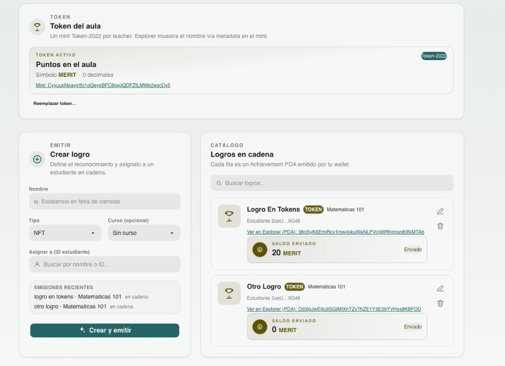

# ScholarFi Lite Contracts

Anchor-based Solana program for **course-linked student credentials** with full PDA CRUD and **classroom reward tokens on SPL Token-2022**.

Teachers manage approved student lists, create courses, issue achievements, and mint classroom points into student ATAs — all as program-derived accounts.

## Frontend

The companion UI for this program is **[ScholarFi Achievement Vault](https://github.com/angeldavid218/scholarfi-achievement-vault/tree/spl-token)** (`spl-token` branch). That app talks to these contracts on Solana (roster, courses, achievements, and Token-2022 classroom rewards).

## Overview

| Entity | PDA seeds | Create | Read | Update | Delete |
|--------|-----------|--------|------|--------|--------|
| `StudentList` | `["student_list", teacher]` | `create_student_list` | RPC fetch | `add_student` / `remove_student` | `close_student_list` |
| `Course` | `["course", teacher, course_id]` | `create_course` | RPC fetch | `update_course` | `close_course` |
| `Achievement` | `["achievement", teacher, student, achievement_id]` | `register_achievement` | RPC fetch | `update_achievement` | `delete_achievement` |
| `RewardConfig` | `["reward_config", teacher]` | `create_reward_mint` | RPC fetch | — | `close_reward_mint` |
| Reward mint (Token-2022) | `["reward_mint", teacher, mint_id]` | `create_reward_mint` | RPC / Explorer | — | `close_reward_mint` (supply 0) |
| `RewardReceipt` | `["reward", achievement]` | `reward_achievement` | RPC fetch | — | — (one-shot) |

Authorization is teacher-centric: list membership is required to register achievements and reward tokens, and course links are validated against a teacher-owned `Course` PDA when `course_id` is set.

## Classroom rewards (SPL Token-2022)

Classroom points use the **[SPL Token-2022](https://spl.solana.com/token-2022)** program (`TokenzQdBNbLqP5VEhdkAS6EPFLC1PHnBqCXEpPxuEb`), not classic SPL Token.

- **One mint per teacher** (versioned by `mint_id` so a teacher can close and replace)
- **Mint-on-award:** `reward_achievement` mints into the student’s associated token account
- **On-mint metadata:** `MetadataPointer` + `TokenMetadata` so Solana Explorer shows the token name/symbol
- **`MintCloseAuthority`:** empty Token-2022 mints can be closed and replaced
- **Decimals:** `6` (whole UI amounts are scaled to base units; avoids Explorer treating 0-decimal mints as NFTs)
- **Exactly-once awards:** a `RewardReceipt` PDA per achievement prevents double-minting

Legacy classic-SPL classroom mints (if any) must be replaced via `close_reward_mint` + `create_reward_mint` before new awards.

## Evidence of functionality (devnet)

End-to-end run via the [ScholarFi Achievement Vault](https://github.com/angeldavid218/scholarfi-achievement-vault/tree/spl-token) UI against program `7JTpTv6ftwRJwyXasGjU7L1swFnrizKh7nEeHnSbVMbs`:

- Classroom **Token-2022** mint `Puntos en el aula` / `MERIT` — [`CyyuupNxavjctfs1qQeypBFC8pxgQDFZtLMWe2eqcDy5`](https://explorer.solana.com/address/CyyuupNxavjctfs1qQeypBFC8pxgQDFZtLMWe2eqcDy5?cluster=devnet)
- Token achievements rewarded on-chain (e.g. **20 MERIT** saldo enviado) with Explorer-linked Achievement PDAs
- Course `Matematicas 101` linked from the catalog



## Program

- **Program name:** `scholarfi_lite_contracts`
- **Program ID (local/devnet):** `7JTpTv6ftwRJwyXasGjU7L1swFnrizKh7nEeHnSbVMbs`

## Accounts

### `StudentList`

Teacher-scoped list of approved student wallets.

- Fields: `teacher`, `bump`, `students: Vec<Pubkey>` (max `100`)

### `Course`

Teacher-owned course that achievements can optionally reference.

- Fields: `teacher`, `course_id`, `title` (max `64` bytes), `active`, `bump`

### `Achievement`

One on-chain achievement record for a student.

- Fields: `student`, `teacher`, `title` (max `128` bytes), `achievement_type` (`Token` \| `Nft`), `course_id: Option<u64>`, `bump`

### `RewardConfig`

Teacher-scoped metadata for the classroom Token-2022 mint.

- Fields: `teacher`, `mint`, `decimals`, `name` (max `32` bytes), `symbol` (max `10` bytes), `bump`

### `RewardReceipt`

Proves a token achievement was rewarded exactly once (stores minted base-unit `amount`).

- Fields: `achievement`, `student`, `mint`, `amount`, `bump`

## Instructions

### Student list

- `create_student_list(students)` — init list PDA; enforces max length
- `add_student(student)` — append wallet; rejects duplicates / over-capacity
- `remove_student(student)` — remove wallet; errors if missing
- `close_student_list()` — close list PDA; rent to teacher

### Course

- `create_course(course_id, title)` — init course PDA (`active = true`)
- `update_course(course_id, title, active)` — update metadata
- `close_course(course_id)` — close course PDA; rent to teacher

### Achievements

- `register_achievement(achievement_id, title, achievement_type, course_id)` — requires student on list; when `course_id` is `Some`, requires matching `Course` account
- `update_achievement(...)` — update title/type/course link; title length enforced
- `delete_achievement(achievement_id)` — close achievement PDA; rent to teacher

### Classroom rewards (Token-2022)

- `create_reward_mint(name, symbol, mint_id)` — init Token-2022 mint PDA + `RewardConfig` with MetadataPointer / TokenMetadata / MintCloseAuthority
- `reward_achievement(achievement_id, amount, mint_id)` — mint `amount` base units into the student ATA; creates `RewardReceipt` (fails if already rewarded or achievement is not `Token`)
- `close_reward_mint(mint_id)` — close `RewardConfig`; closes the Token-2022 mint when supply is zero (for replace flow)

### Misc

- `initialize()` — scaffold entrypoint (no persistent state)

## Error Conditions

- `StudentNotOnList` / `StudentAlreadyOnList` / `StudentNotFound`
- `StudentListTooLarge` / `UnauthorizedTeacher`
- `TitleTooLong` / `CourseTitleTooLong`
- `UnauthorizedCourseTeacher` / `CourseRequired` / `CourseIdMismatch`
- `RewardNameEmpty` / `RewardNameTooLong` / `RewardSymbolEmpty` / `RewardSymbolTooLong`
- `InvalidRewardAmount` / `AchievementNotToken`
- `RewardMintMismatch` / `TokenProgramMustBeToken2022`
- `RewardMintSupplyNonZero` / `RewardMintIdMismatch`

## Local Development

### Prerequisites

- Rust toolchain
- Solana CLI (`cargo-build-sbf`)
- Anchor CLI
- Yarn

### Build

```bash
anchor build
# or (use --arch v1 for LiteSVM 0.10 compatibility with current platform-tools)
cargo-build-sbf --manifest-path programs/scholarfi-lite-contracts/Cargo.toml --arch v1
```

### Test

```bash
# requires target/deploy/scholarfi_lite_contracts.so from build
cargo test -p scholarfi-lite-contracts
```

LiteSVM integration tests cover:

- StudentList create → add → remove → close
- Course create → update → close
- Achievement register (with course) → update → delete, plus `StudentNotOnList` failure
- Token-2022 reward mint create → mint-once into student ATA → reject double award / invalid awards
- Close + recreate reward mint (`mint_id` bump)

## Project Structure

- `programs/scholarfi-lite-contracts/src/lib.rs` — entrypoints and account contexts
- `programs/scholarfi-lite-contracts/src/state.rs` — `StudentList`, `Course`, `Achievement`, `RewardConfig`, `RewardReceipt`
- `programs/scholarfi-lite-contracts/src/instructions/` — per-instruction handlers (incl. `create_reward_mint`, `reward_achievement`, `close_reward_mint`)
- `programs/scholarfi-lite-contracts/src/error.rs` — custom error codes
- `programs/scholarfi-lite-contracts/src/constants.rs` — seeds, Token-2022 decimals, amount limits
- `programs/scholarfi-lite-contracts/tests/` — LiteSVM CRUD + reward tests
