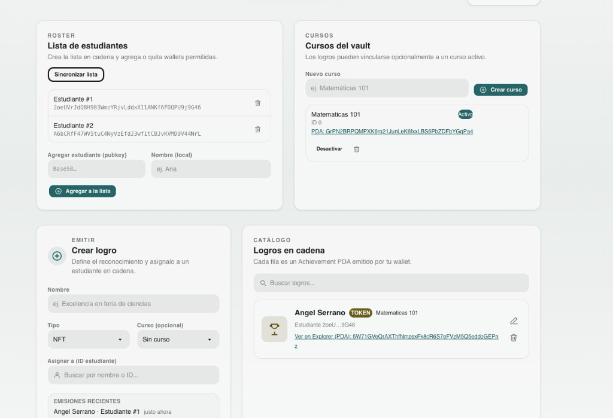

# ScholarFi Lite Contracts

Anchor-based Solana program for **course-linked student credentials** with full PDA CRUD.

Teachers manage approved student lists, create courses, and issue achievements that can optionally reference a course — all as program-derived accounts.

## Overview

| Entity | PDA seeds | Create | Read | Update | Delete |
|--------|-----------|--------|------|--------|--------|
| `StudentList` | `["student_list", teacher]` | `create_student_list` | RPC fetch | `add_student` / `remove_student` | `close_student_list` |
| `Course` | `["course", teacher, course_id]` | `create_course` | RPC fetch | `update_course` | `close_course` |
| `Achievement` | `["achievement", teacher, student, achievement_id]` | `register_achievement` | RPC fetch | `update_achievement` | `delete_achievement` |

Authorization is teacher-centric: list membership is required to register achievements, and course links are validated against a teacher-owned `Course` PDA when `course_id` is set.

## Evidence of functionality (devnet)

End-to-end run via the ScholarFi Achievement Vault UI against program `7JTpTv6ftwRJwyXasGjU7L1swFnrizKh7nEeHnSbVMbs`:

- Student roster synced on-chain (2 wallets)
- Course `Matematicas 101` created (`course_id = 0`) — PDA [`GrPN2BRPQMPXK6rg21JunLek6fxxLBS6PbZDFbYGqPa4`](https://explorer.solana.com/address/GrPN2BRPQMPXK6rg21JunLek6fxxLBS6PbZDFbYGqPa4?cluster=devnet)
- Achievement issued for Angel Serrano linked to that course — PDA [`5W71GVeQrAXThfNmzexFk8cR6S7eFVzM5Q5eddoGEPnz`](https://explorer.solana.com/address/5W71GVeQrAXThfNmzexFk8cR6S7eFVzM5Q5eddoGEPnz?cluster=devnet)



## Program

- **Program name:** `scholarfi_lite_contracts`
- **Program ID (local/devnet):** `7JTpTv6ftwRJwyXasGjU7L1swFnrizKh7nEeHnSbVMbs`

## Accounts

### `StudentList`

Teacher-scoped list of approved student wallets.

- Fields: `teacher`, `bump`, `students: Vec<Pubkey>` (max `100`)

### `Course`

Teacher-owned course that achievements can optionally reference.

- Fields: `teacher`, `course_id`, `title` (max `64` bytes), `active`, `bump`

### `Achievement`

One on-chain achievement record for a student.

- Fields: `student`, `teacher`, `title` (max `128` bytes), `achievement_type` (`Token` \| `Nft`), `course_id: Option<u64>`, `bump`

## Instructions

### Student list

- `create_student_list(students)` — init list PDA; enforces max length
- `add_student(student)` — append wallet; rejects duplicates / over-capacity
- `remove_student(student)` — remove wallet; errors if missing
- `close_student_list()` — close list PDA; rent to teacher

### Course (new)

- `create_course(course_id, title)` — init course PDA (`active = true`)
- `update_course(course_id, title, active)` — update metadata
- `close_course(course_id)` — close course PDA; rent to teacher

### Achievements

- `register_achievement(achievement_id, title, achievement_type, course_id)` — requires student on list; when `course_id` is `Some`, requires matching `Course` account
- `update_achievement(...)` — update title/type/course link; title length enforced
- `delete_achievement(achievement_id)` — close achievement PDA; rent to teacher

### Misc

- `initialize()` — scaffold entrypoint (no persistent state)

## Error Conditions

- `StudentNotOnList` / `StudentAlreadyOnList` / `StudentNotFound`
- `StudentListTooLarge` / `UnauthorizedTeacher`
- `TitleTooLong` / `CourseTitleTooLong`
- `UnauthorizedCourseTeacher` / `CourseRequired` / `CourseIdMismatch`

## Local Development

### Prerequisites

- Rust toolchain
- Solana CLI (`cargo-build-sbf`)
- Anchor CLI
- Yarn

### Build

```bash
anchor build
# or (use --arch v1 for LiteSVM 0.10 compatibility with current platform-tools)
cargo-build-sbf --manifest-path programs/scholarfi-lite-contracts/Cargo.toml --arch v1
```

### Test

```bash
# requires target/deploy/scholarfi_lite_contracts.so from build
cargo test -p scholarfi-lite-contracts
```

LiteSVM integration tests cover:

- StudentList create → add → remove → close
- Course create → update → close
- Achievement register (with course) → update → delete, plus `StudentNotOnList` failure

## Project Structure

- `programs/scholarfi-lite-contracts/src/lib.rs` — entrypoints and account contexts
- `programs/scholarfi-lite-contracts/src/state.rs` — `StudentList`, `Course`, `Achievement`
- `programs/scholarfi-lite-contracts/src/instructions/` — per-instruction handlers
- `programs/scholarfi-lite-contracts/src/error.rs` — custom error codes
- `programs/scholarfi-lite-contracts/src/constants.rs` — seeds and limits
- `programs/scholarfi-lite-contracts/tests/` — LiteSVM CRUD tests
